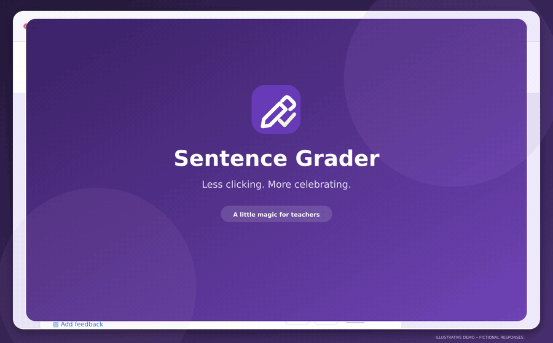

<div align="center">


# Sentence Grader ✏️💜

**Less clicking. More encouraging. Occasional confetti.**

A friendly Chrome extension that helps teachers grade sentence-count responses in Google Forms, one little victory at a time.

  

</div>

---



*A quick tour through fictional responses,
with a well-earned confetti finale.*

## What it does

Some writing assignments ask students to write at least six complete sentences. Counting and scoring each response manually can take a while. Sentence Grader gives the teacher a head start while keeping them in control of the final grade.

- **Counts likely sentences** and proposes scores according to a simple rubric.
- **Flags uncertain answers** for manual review instead of automatically filling them.
- **Fills blank scores only**, preserving grades you've already entered.
- **Shows sentence-count badges** in their own small row beneath each response. Blank answers also show whether they're ready to fill or need review, and the extension reports if a fill attempt doesn't stick. Scored answers leave the normal review list.
- **Jumps to the next ungraded answer** with a gentle highlight on the Google Forms card and the matching preview, including after the native ✓ and ✕ grading buttons update a score.
- **Adapts to smaller screens.** After Next ungraded, the panel shrinks to keep the active score box clear, and the launcher returns if there's no room.
- **Marks ambiguous text** with short squiggly underlines on the suspected sentence starts, plus compact, locally bundled Tippy.js explanations anchored to each mark with extra spacing and constrained to the visible Forms scroll area.
- **Uses Google Forms' own Save grades control** rather than submitting grades through a separate service.
- **Celebrates progress** with personalized motivational toasts, optional confetti, and a tiny trumpet fanfare. 🎺
- **Remembers preferences**, including the grader's name. (Hi, Berlin! 👋)

All processing happens in your browser. No accounts, analytics, external grading API, or transmission of student responses.

## Quick start

1. Download the source ZIP or clone this repository.
2. Open Chrome and visit `chrome://extensions`.
3. Turn on **Developer mode**.
4. Click **Load unpacked** and select the folder containing `manifest.json`.
5. Open your Google Form editor, navigate to **Responses → Question**, and select the paragraph question you're grading.
6. Click the purple pencil-and-check button at the bottom-right of the page.

That's it! The extension scans currently visible answers when opened. No separate Scan button is needed.

> **Tip:** Load the unpacked *folder*, not the ZIP. Unzip first.

## Create a practice Google Form 🧪

Want a safe place to test the extension without touching classroom data? The repository includes a ready-to-run Google Apps Script: [scripts/create-test-form.gs](scripts/create-test-form.gs).

1. Open [Google Apps Script](https://script.google.com) and start a **New project**.
2. Open the default `Code.gs` editor, remove the starter function, and paste in the contents of `scripts/create-test-form.gs`.
3. Select `setupSentenceGraderTest` in the function dropdown and click **Run**. You do **not** need to Deploy the script.
4. On the first run, approve the Google Forms and script-property permissions requested by Apps Script. Use your own test account.
5. Open the **Execution log**. At the very end, find the direct edit URL on its own line. Click it if Apps Script makes it a link, or copy it into Chrome.
6. In the Form editor, select **Responses → Question**, choose the six-point writing question, and open Sentence Grader from the purple launcher.

The script creates a new quiz with a zero-point test ID question, a six-point **activism** paragraph question, and **14 fictional submissions**. The responses resemble real classroom writing in length and style while being entirely invented. They cover six-sentence and five-sentence answers, long complex sentences, lowercase starts, missing spaces after periods, abbreviations, quotations, ellipses, missing punctuation, line breaks, and fragments. Writing answers start ungraded, ready for a real workflow test.

**A fresh form every time:** Running `setupSentenceGraderTest` always creates a **new** Form with a timestamp in its title and 14 new fictional responses. Previous test forms remain untouched. If you want to return to the latest form and add only missing cases, choose `reuseLatestSentenceGraderTest` instead. The older `createFreshSentenceGraderTest` command also creates a new form.

> **Please don't run the fixture against a real class Form.** It is a standalone script that generates fictional data under your account. Test with that Form first, and always verify scores after saving and reloading. Apps Script doesn't need to be deployed as a web app.

## The scoring rule

| Detected sentences | Proposed score |
| :---: | :---: |
| 0–3 | 3 points |
| 4 | 4 points |
| 5 | 5 points |
| 6 or more | 6 points |

This rubric is fixed in v1.0 and expects a **six-point** Google Forms question.

### The human-in-the-loop part

Sentence counting isn't the same as determining whether a sentence is grammatically complete. Following teacher feedback, **v1.0.1 counts sentences without policing grammar**. Fragments, very short answers, and list-style answers are counted by their text. Only especially ambiguous missing punctuation and empty answers hold back automatic filling.

Some intentional conventions:

- A sentence without final punctuation can still count.
- Separate nonempty lines can count as separate sentences.
- An ellipsis is a sentence boundary.
- Repeated exclamation/question marks count as one boundary.
- Common abbreviations and decimal points are not sentence endings.
- A run-on without punctuation generally counts as one sentence.
- Punctuation inside parentheses does not create extra sentence boundaries.
- Punctuation inside quotes *does* end a sentence.

**Always review the preview and scores before saving.** Students deserve a teacher's judgment, not a punctuation-only verdict.

## A typical grading session

1. **Open Sentence Grader.** Count badges appear on each visible response, and the panel proposes scores for ungraded ones.
2. Click **Fill blanks** to populate confidently detected, empty score fields.
3. Click **Next ungraded** to find a response that needs attention. The card aligns with the top of the viewport so you can read it first; the panel expands as you scroll toward the score box. Strong punctuation ambiguities receive a squiggly underline with a hover explanation.
4. Review or edit the grades.
5. Click **Save grades** in Google Forms, or use the extension's Save button when the native control is available.
6. When every visible response has a score, the all-done screen invites you to **Launch confetti!** You earned it. 🎉 Native ✓ and ✕ actions get progress toasts too.

The toolbar stays at the top while the answer preview scrolls.

## Make it yours

Open the gear icon in the extension header:

| Setting | What it changes |
| --- | --- |
| Encouragement toasts | Small purple progress messages |
| Finish-line confetti | Automatic confetti after an acknowledged final save |
| Celebration volume | Short locally synthesized fanfare; slide to zero to mute |
| Grader name | Occasional personal encouragement; defaults to **Berlin** |
| Review missing punctuation | Hold obviously ambiguous answers for a teacher's decision (on by default) |
| Count separate lines | Treat each nonempty line as a sentence boundary (on by default) |
| Ellipses as boundaries | Count an ellipsis as a sentence break (on by default) |

Preferences persist locally in Chrome. There's a **Test trumpet** button to check audio playback. Messages span decades, from “bee's knees” to “main-character energy,” and rotate to avoid repetition. Toasts are slightly larger and animate gently; reduced-motion preferences are respected. Sentence-rule changes affect suggestions and review flags, not already-entered grades.

## Privacy and permissions 🔒

The manifest requests only the `storage` extension permission, which remembers the grader's name and celebration settings. The content script runs only on Google Forms editor URLs: `https://docs.google.com/forms/d/*/edit*`.

Student answers are read in-memory to count sentences and display a local preview. The extension doesn't send them anywhere, store them, or include them in reports. Tippy.js and Popper are bundled locally, with their licenses recorded in [vendor/THIRD_PARTY_NOTICES.md](vendor/THIRD_PARTY_NOTICES.md). There are no CDN requests, analytics, external fonts, or grading servers.

See [PRIVACY.md](PRIVACY.md) for more detail.

## Important limitations

- **Teacher-assist, not automated assessment.** Grammar and sentence completeness can be ambiguous.
- **Google Forms can change its HTML.** The extension depends on observed editor markup.
- **Visible cards define progress.** Identical answers may be grouped, and not-yet-rendered answers may be absent.
- **Google Forms handles saving.** The extension's UI feedback is not independent server-side confirmation. Reload and verify important grades persisted.
- **The rubric is hardcoded** and is not yet configurable.
- **Chrome desktop first.** Not a mobile Chrome extension.

Test with fictional responses before real classroom use.

## Development

No build system or runtime dependencies are required. It's plain JavaScript, CSS, SVG, and PNG.

```bash
npm test
npm run check
```

```text
sentence-grader/
├── manifest.json       Chrome Manifest V3 configuration
├── content.js          Google Forms integration and UI
├── grader.js           Sentence-counting logic
├── confetti.js         Local canvas confetti
├── icons/              SVG source and Chrome PNG icons
├── vendor/             Local Tippy.js, Popper, CSS and license notices
├── tests/              Sentence-counting tests
├── manual-tests/       Browser smoke test (requires runnable Chromium)
├── PRIVACY.md          Data handling and permissions
└── README.md           You are here
```

For browser diagnostics, open DevTools and filter the Console for `[Sentence Grader]`. Logs describe events and score counts, not student answer text.

## Contributing

Found a sentence edge case? Have a pun worthy of the confetti cannon? Open an issue with a **fictional** example and the result you expected. Please do not share real student submissions, names, or grades in GitHub issues or screenshots.

See [CONTRIBUTING.md](CONTRIBUTING.md).

## Project status

**v1.0.1: live-feedback test candidate.** The sentence counter passes its test suite. Browser interactions still need hands-on confirmation on the new fictional Form, particularly at Berlin's screen size. Google Forms UI compatibility is subject to changes in Google's editor.

Made with 💜 for teachers who deserve a little celebration after a lot of grading.
